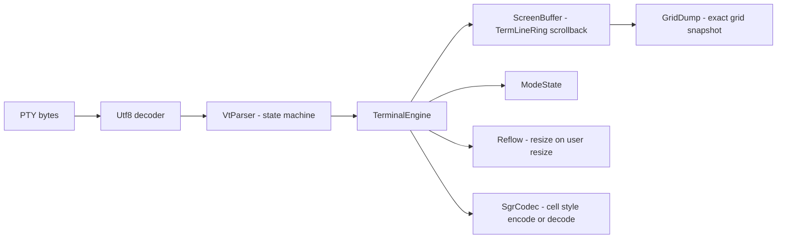

# aterminal-engine

A **pure-Kotlin VT/xterm terminal engine**: a state machine that consumes PTY
byte streams and maintains a terminal grid — no native code, no Android dependency.
The only runtime dependency is `kotlin-stdlib`.

The engine is conformance-first: during development its grid dumps were compared
**exact-string** against `@xterm/headless` 5.5.0 with `@xterm/addon-unicode11` 0.8.0 active,
on a curated corpus (13 replay streams, 204 escape-sequence units and 47 reflow cases). That corpus and harness are not published
yet; this repository ships the hermetic unit tests and the dump tools described below. Where xterm has a quirk, this engine keeps the same quirk —
bug-compatible on purpose, because "matches xterm" is the contract a terminal app needs.

[](LICENSE)


> Extracted from A-Terminal, an Android terminal app (not published yet), where it is the
> JVM-only `:engine` module.
>
> Parts of the engine are derived from [xterm.js](https://github.com/xtermjs/xterm.js)
> (MIT), see [THIRD_PARTY_NOTICES.md](THIRD_PARTY_NOTICES.md). This project is not
> affiliated with or endorsed by the xterm.js project.

## What's inside



| Package | Role |
|---|---|
| `dev.aterminal.engine.vt` | `VtParser` — pure parser (ANSI/VT100..VT525 subset that xterm implements), UTF-8 aware |
| `dev.aterminal.engine.term` | grid model: `ScreenBuffer`, `TermLineRing` (scrollback with O(1) eviction), `Reflow`, `SgrCodec`, `Unicode` (Unicode 11 character widths) |
| `dev.aterminal.engine` | `TerminalEngine` (write/resize API), `GridDump` (serializable grid snapshot), conformance mains |

## Quick start

```kotlin
val engine = TerminalEngine(cols0 = 80, rows0 = 24, historySize = 9001)
engine.write("Hello\r\n".toByteArray())          // or: VtParser(engine).feed(bytes)

val dump = GridDump.dump(engine)                 // exact grid snapshot (JSON: cells, styles, cursor)
```

Reflow runs automatically on `engine.resize(cols, rows)` and matches xterm's default
behaviour (including its known quirks — see tests).

## Build / test

```bash
./gradlew test          # hermetic JVM tests (parser, grid, flood-eviction bounds, fuzz-no-throw)
./gradlew build
```

JDK 17+, Gradle wrapper included.

## Conformance harness

The repo ships the producer side of the conformance bridge (no external corpus needed
for the unit tests):

```bash
./gradlew -q dumpGrid      -Praw=<raw-bytes>  -Pout=<grid.json> [-Pcols=80 -Prows=24 -Phistory=9001]
./gradlew -q dumpGridBatch -Plist=<listfile>   # one JVM for all units
./gradlew -q engineSteps   -Psteps=<steps> -Pout=<grid.json>
```

Feed the same raw bytes to `@xterm/headless` and compare `GridDump` JSON to check
equivalence yourself. This is how the engine was validated during development.

## Notes on fidelity

- Character widths follow Unicode 11 from `@xterm/addon-unicode11` (emoji are width 2),
  **not** xterm's default `UnicodeV6`. To compare with xterm, activate that addon. A test pins
  every codepoint from U+0020 up, so results do not depend on the runtime's Unicode version.
- Zero-width combining marks attach to the preceding cell. ZWJ emoji sequences are not treated
  as one grapheme: each emoji keeps its own cells, as in xterm with this addon.
- Scrollback eviction is O(1) and bounded — flood tests pin heap behaviour under `-Xmx256m`.
- No IME/rendering concerns here: this is the model layer only.

## License

MIT — see [LICENSE](LICENSE). Third-party attributions are in
[THIRD_PARTY_NOTICES.md](THIRD_PARTY_NOTICES.md).
